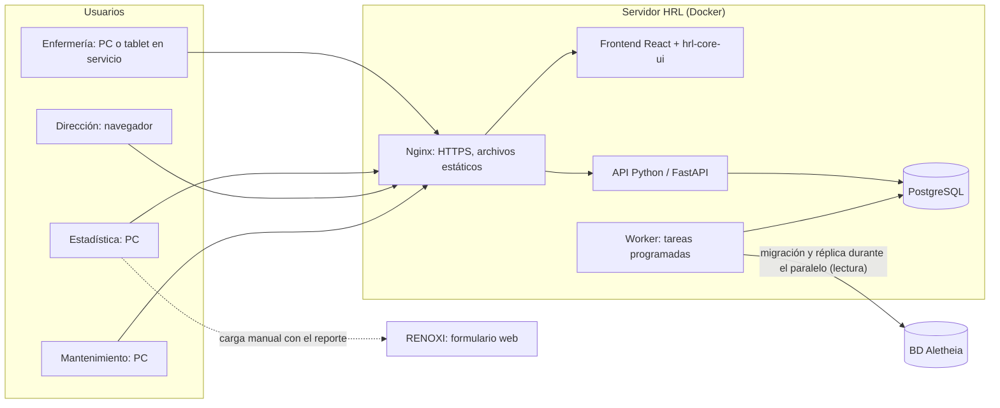
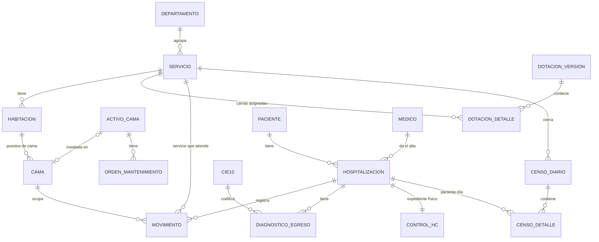

# Arquitectura

## Vista general

Aplicación web monolítica modular: un frontend, una API, una base de datos y
un proceso de tareas programadas. Corre en servidores del hospital mientras la
Dirección no avale alojar datos de salud en la nube (Ley 29733).

## Componentes

| Componente | Responsabilidad | Tecnología |
|---|---|---|
| Frontend | Pantallas de los 12 módulos; editor y vista del plano en SVG; flujo de teclado en la bandeja | React 19 + Vite 8 (JavaScript), `@hrl/core-ui` |
| Actualización de pantallas | Refresca el estado de camas | Recarga periódica en el piloto; Server-Sent Events con `LISTEN/NOTIFY` de PostgreSQL más adelante |
| API | Reglas de negocio, validaciones, cuadre de censo, cálculo de indicadores, permisos, auditoría | Python 3.12, FastAPI, SQLAlchemy, Alembic |
| Worker | Réplica de Aletheia, recordatorios de censo sin cerrar, precálculo de reportes, alertas de calidad | Python (mismo código que la API), APScheduler o Celery |
| Base de datos | Única fuente de movimientos, censos, egresos y maestros | PostgreSQL 16 |
| Proxy | HTTPS, compresión, sirve el frontend | Nginx |
| Reportes | Exportación Excel/PDF | openpyxl, WeasyPrint |

La API se organiza en módulos internos que siguen los de negocio
(`maestros`, `pacientes`, `camas`, `movimientos`, `censo`, `egresos`,
`reportes`, `integracion`, `seguridad`). Un monolito modular basta para el
volumen (≈ 250 camas, decenas de usuarios) y lo mantiene un equipo pequeño.

## Integraciones

| Sistema | Dirección | Datos | Cómo |
|---|---|---|---|
| Aletheia | Migración (lectura) | Pacientes/HC, CIE-10, médicos, servicios, histórico de egresos | Conexión de solo lectura a su BD; carga a tablas `stg_aletheia_*`, deduplicación y paso a maestros. Réplica nocturna solo durante el paralelo; luego se apaga |
| RENOXI | Salida manual | Camas, ocupadas con/sin O2 o VM | Sin API: reporte con el mismo orden del formulario; se registra la fecha de carga |
| DIRESA | Salida manual | Indicadores mensuales | Excel/PDF |
| Autenticación | — | Cuentas por área | Cuentas locales del sistema, administradas por TI |
| Patrimonio | Entrada (por definir) | Códigos patrimoniales de camas | Importación del registro de Patrimonio si existe (reunión 29/10/2026) |

## Datos

### Modelo

| Tabla | Campos clave |
|---|---|
| `departamento` | nombre, en_dotacion, reporte_diresa |
| `servicio` | departamento, nombre único, modalidad_captura (papel/digital), fila_renoxi, activo |
| `habitacion` | ID del mapeo, servicio, piso, nombre, posición y tamaño en el plano (x, y, ancho, alto) |
| `cama` | puesto de cama: ID del mapeo, habitación, servicio_dueño, tipo, restricciones, estado (libre, ocupada, bloqueada, fuera de servicio), posición y orientación en la habitación |
| `activo_cama` | código interno (obligatorio, va en la etiqueta QR), código patrimonial (opcional), tipo, cama (puesto) actual, estado (en uso, reportada, en mantenimiento, en almacén, de baja) |
| `orden_mantenimiento` | activo, puesto de origen, falla, reportado_por, fechas de reporte/retiro/reparación/entrega/recepción, con_reemplazo, resultado (reparada, de baja), estado |
| `dotacion_version` | nombre, documento, vigente_desde, vigente_hasta |
| `dotacion_detalle` | versión, servicio, n_camas |
| `paciente` | n_hc, tipo y n° de documento, nombres, sexo, fecha_nacimiento, origen (aletheia/local) |
| `hospitalizacion` | paciente, fecha_ingreso, procedencia, dx_ingreso, fecha_egreso, tipo_egreso, condicion_egreso, medico_alta, estado (registrado, pendiente_hc, completo, observado, validado, cerrado) |
| `movimiento` | hospitalizacion, tipo (ingreso, traslado, prestamo, soporte, egreso), fecha_hora, servicio_atiende, cama, servicio_origen, servicio_destino, soporte (ninguno/O2/VM), anulado, motivo_anulacion |
| `diagnostico_egreso` | hospitalizacion, cie10, principal |
| `control_hc` | hospitalizacion, estado (pendiente, recibida, completada, devuelta), fechas, usuario |
| `censo_diario` | servicio, fecha, estado (abierto, cerrado, reabierto), saldo_anterior, ingresos, traslados_entrada, egresos, traslados_salida, saldo_actual, observación, cerrado_por |
| `censo_detalle` | censo, hospitalizacion, cama, prestada, soporte (foto a la hora de corte) |
| `periodo` | año, mes, estado (abierto, cerrado), dotación usada |
| `parametro` | clave, valor, vigente_desde |
| `auditoria` | tabla, id, acción, valor_anterior, valor_nuevo, usuario, fecha_hora |

Notas de diseño:

- **El movimiento es la fuente.** Ocupación actual, censo, estancias y
  pacientes-día se derivan de `movimiento`; `censo_detalle` es la foto
  inmutable al cerrar, para que los reportes no cambien si después se corrige
  un movimiento sin reabrir el censo.
- **Nada se borra**: anulaciones con motivo y auditoría por trigger en
  PostgreSQL (no depende de que la API lo recuerde).
- **Restricciones en la base**: una sola hospitalización abierta por paciente
  (índice único parcial), una sola ocupación por cama en un instante
  (constraint de exclusión sobre rangos de tiempo).
- Indicadores mensuales como vistas materializadas que se refrescan al cerrar
  censos y al cerrar el mes.
- **Vista isométrica**: el plano se guarda como datos (posición de
  habitaciones y puestos en una cuadrícula por piso) y el frontend lo dibuja
  en SVG con proyección isométrica. No hay modelos 3D que mantener: cambiar
  la distribución es editar coordenadas. Ver
  [0004](decisiones/0004-vista-isometrica-svg.md).
- **Actualización de pantallas**: como el registro puede ser diferido, el
  sistema es un consolidado al día, no un monitor al minuto. En el piloto
  basta con recargar el estado al registrar y cada pocos minutos. SSE con
  `LISTEN/NOTIFY` queda para cuando se sumen pantallas de monitoreo.
  Cada servicio muestra "último registro: hh:mm" para que se sepa qué tan al
  día está.

### Acceso y protección

- Datos personales y de salud: acceso por rol y por servicio; el tablero y
  los reportes agregados no muestran datos personales. No hay pantallas de
  acceso público.
- Una cuenta por área. La bitácora registra la cuenta y el equipo (IP) de
  cada operación.
- HTTPS en la red interna; contraseñas con hash; sesión con expiración por
  inactividad; cambio de contraseña de un área cuando alguien deja de
  trabajar en ella.
- Respaldo diario de PostgreSQL con retención de 30 días y copia fuera del
  servidor; prueba de restauración trimestral.
- Cumplimiento de la Ley 29733 de protección de datos personales.

## Despliegue

- `docker compose` con `nginx`, `api`, `worker`, `db` en un servidor del
  hospital. Ambientes: desarrollo (local), pruebas y producción.
- Migraciones de base con Alembic, ejecutadas al desplegar.
- Publicación: TI construye las imágenes desde la rama `main` y despliega en
  la ventana acordada con Estadística (fuera de la hora de corte del censo).
- Contingencia: si el sistema no está disponible, los servicios usan el censo
  en papel nuevo y Estadística lo transcribe después en modo transcripción.
