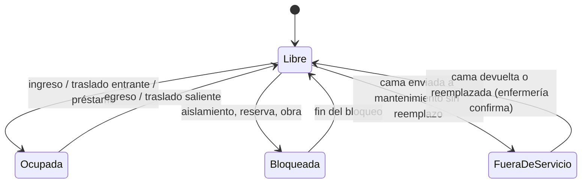
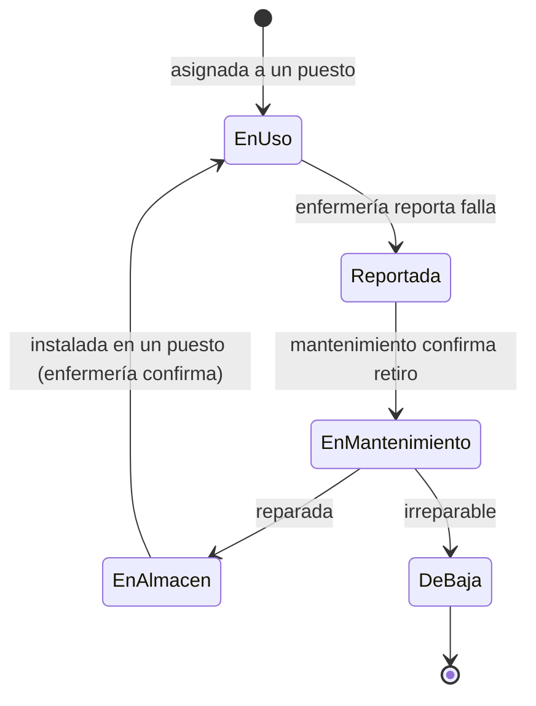

# Camas, habitaciones y mantenimiento

Hoy, si una cama está en mal estado se llama a mantenimiento para que se la
lleve y no queda registro. La dotación además se cuenta en papel. El sistema
lleva un inventario real de camas por habitación, con su estado y su
historial de mantenimiento, y lo usa para calcular disponibles e indicadores.

## Jerarquía física

**Departamento → servicio → habitación → puesto de cama**, y cada puesto
puede tener asignado un **activo cama** (la cama física).

| Concepto | Qué es | Identificador |
|---|---|---|
| Habitación | Sala física dentro de un servicio, con piso y posición en el plano | ID habitación (p. ej. `MED-H03`) |
| Puesto de cama | Lugar fijo de la habitación donde se hospitaliza a un paciente. Es lo que se ocupa, se presta y cuenta en la dotación | ID cama (p. ej. `MED-H03-C2`), el del mapeo físico |
| Activo cama | Cama física. Es lo que va a mantenimiento | Código interno del sistema (siempre) + código patrimonial (si existe) |

Separar puesto y activo cubre los dos casos:

- **Sin reemplazo** (lo que pasa hoy en Medicina, con 1 cama de A y 1 de B en
  mantenimiento): el espacio queda intacto y el puesto pasa a **fuera de
  servicio** hasta que la cama vuelva. El puesto no se borra ni deja de
  existir en el plano.
- **Con reemplazo**: el puesto sigue operativo con otro activo, y la historia
  del paciente no cambia de ID de cama.

### Identificador de la cama física

Muchas camas no tienen código patrimonial. Toda cama tendrá igual un
**código interno** del sistema, impreso en una etiqueta (con QR) pegada a la
cama, y el código patrimonial se guarda cuando exista. De la reunión con
Patrimonio (29/10/2026) depende si sus registros sirven como fuente inicial
del inventario o si el inventario se levanta desde cero con el programa de
etiquetado.

## Estándar de camas

El plano se dibuja a escala con medidas fijas por tipo de cama, para que
todas las camas de un tipo midan lo mismo y la capacidad de cada habitación
se pueda comparar. Están en `frontend/src/app/dominio/estandar.js`.

| Tipo | Ancho × largo |
|---|---|
| Adulto | 1,00 × 2,25 m |
| UCI / intermedios | 1,25 × 2,25 m |
| Pediátrica | 0,75 × 1,50 m |
| Cuna / incubadora | 0,50 × 1,00 m |

| Distribución | Medida |
|---|---|
| Cabecera a la pared | Apoyada (0 m) |
| Entre camas | 1,00 m |
| Primera y última cama a la pared lateral | 1,00 m |
| Libre a los pies (una fila) | 1,25 m |
| Pasillo entre dos filas enfrentadas | 1,75 m |

**Cuadrícula exacta.** Todas las medidas, separaciones y posiciones son
múltiplos de 25 cm. Habitaciones, camas y medidas escritas a mano se ajustan
a esa cuadrícula, así las camas quedan alineadas entre sí y con las paredes,
y siguen alineadas al mover la habitación o una cama. Los planos guardados
con la versión anterior (medidas al centímetro) se ajustan solos al abrirlos.

### Distribuciones

Cada plantilla (1, 2, 3, 4, 6 u 8 camas) tiene sus variantes. Una cama
**horizontal** tiene la cabecera contra la pared izquierda o derecha; una
**vertical**, contra la de arriba o la de abajo.

| Variante | Cómo quedan las camas |
|---|---|
| Dos filas, camas horizontales (**por defecto**) | Dos filas que corren de arriba abajo, cabeceras contra las paredes izquierda y derecha |
| Dos filas, camas verticales | Dos filas que corren de izquierda a derecha, cabeceras arriba y abajo |
| Una fila a la izquierda / a la derecha | Camas horizontales contra esa pared |
| Una fila arriba / abajo | Camas verticales contra esa pared |

La de dos filas horizontales es la habitual del hospital (las habitaciones
de 4 camas tienen las camas en horizontal). Con una sola cama solo se
ofrecen las de una fila. Una habitación estándar de 4 camas mide
6,25 × 5,00 m con camas horizontales y 5,00 × 6,25 m con verticales.

### Numeración de camas

Las camas toman su código del de la habitación, y se pueden renumerar desde
el panel de la habitación, para esa habitación o para todo su servicio:

| Formato | Ejemplo (habitación 101) |
|---|---|
| Habitación-C + número | 101-C1, 101-C2… |
| Habitación-número | 101-1, 101-2… |
| Habitación-letra | 101-A, 101-B… |
| Habitación y letra sin guion | 101A, 101B… |
| Correlativo con prefijo (sigue entre habitaciones) | MA-1 … MA-24 |

Se elige el número de inicio y el orden (por filas o por columnas), con vista
previa. Si un código nuevo ya lo usa otra cama, no se aplica. Cada cama se
puede renombrar a mano, y al renombrar una habitación sus camas con ese
prefijo lo siguen. Son medidas de trabajo para dibujar: antes de usarlas para
decidir capacidad se validan con Infraestructura contra la norma técnica de
infraestructura hospitalaria del MINSA. El editor avisa cuando dos camas
quedan más juntas que el estándar, sin impedirlo: el plano refleja lo que hay.

## Estados del puesto de cama



- **Ocupada** con préstamo: la cama es de un servicio y el paciente lo
  atiende otro (cuenta para el que atiende).
- **Fuera de servicio**: no está disponible. Si cuenta o no en los
  indicadores DIRESA está pendiente de definir (ver preguntas).
- Estado opcional **En limpieza** entre el egreso y Libre, si se decide medir
  el tiempo de recambio de cama.

## Estados del activo cama



## Flujo de mantenimiento

```mermaid
sequenceDiagram
  participant E as Enfermería (censo)
  participant S as Sistema
  participant M as Mantenimiento
  E->>S: Novedad en el censo: cama X con falla (descripción)
  S->>M: Orden de mantenimiento abierta (pendiente de retiro)
  M->>S: Confirma retiro; ¿deja cama de reemplazo?
  alt Con reemplazo
    S->>S: Puesto sigue Libre con el activo nuevo
  else Sin reemplazo
    S->>S: Puesto pasa a Fuera de servicio
  end
  M->>S: Diagnóstico y cierre: reparada o de baja
  M->>S: Entrega cama al servicio
  E->>S: Confirma recepción en el censo
  S->>S: Puesto vuelve a Libre; orden cerrada con tiempos
```

Reglas:

- La falla se registra en el **censo diario**, en una sección "Novedades de
  camas" (también en el formato en papel de la transición).
- La orden no se cierra hasta que las dos partes confirman: mantenimiento la
  entrega y enfermería la recibe. Si una sola parte confirma, aparece en la
  lista de validación.
- **Cuadre diario de inventario**: puestos fuera de servicio según censo
  contra órdenes abiertas según mantenimiento. Las diferencias van a
  validación, igual que el cuadre de pacientes.
- Cada orden guarda tiempos (reporte, retiro, reparación, devolución) para
  medir días-cama perdidos por mantenimiento.

## Camas reales y dotación

- El mapeo físico (conteo presencial por habitación) es la fuente del maestro
  de puestos de cama. Ya está hecho para Medicina, Psiquiatría, Quemados,
  Infectología y Oncología.
- Se mantienen dos números por servicio y día:
    - **Dotación oficial**: la de la resolución vigente, versionada.
    - **Camas operativas**: puestos del mapeo menos los fuera de servicio de
      ese día.
- Los indicadores se calculan con las dos bases y el reporte indica cuál usa
  DIRESA (pendiente de definir con Estadística).
