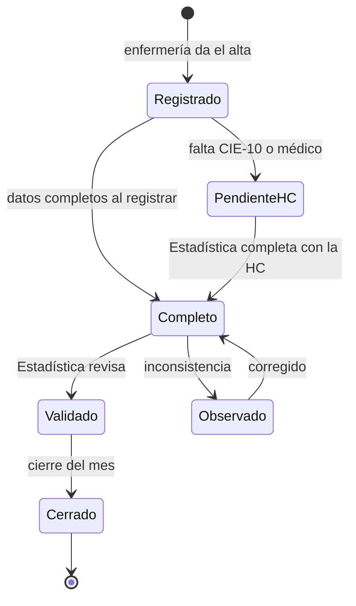

# Completado desde la HC física

Las historias clínicas son de papel y lo seguirán siendo. El CIE-10 de egreso
y el médico que dio el alta solo existen en la HC. El diseño parte de tres
ideas:

1. **Capturar cada dato donde nace.** Lo que enfermería sabe en el momento
   (cama, hora, tipo de movimiento, soporte O2/VM) lo registra enfermería.
   Lo que solo está en la HC lo completa Estadística con la HC en la mano.
2. **No volver a buscar lo que el sistema ya sabe.** La fecha de ingreso deja
   de reconstruirse: queda registrada al ocupar la cama.
3. **Un egreso incompleto no se pierde ni bloquea el censo.** Se cuenta para
   camas y censo desde el alta, y entra en una bandeja hasta tener sus datos
   clínicos.

## Qué dato viene de dónde

| Dato | Hoy | Con el sistema |
|---|---|---|
| N° de HC, nombre, edad, sexo | Enfermería lo escribe a mano | Se busca en el padrón (réplica de Aletheia) por HC o DNI; se escribe solo si es paciente nuevo |
| Cama | Enfermería | Enfermería (se elige en el mapa de camas) |
| Fecha de ingreso | Recepcionistas la buscan en HC/Aletheia | Automática: fecha del movimiento de ingreso |
| Tipo de movimiento | No existe | Enfermería: ingreso, traslado, préstamo, egreso |
| Servicio origen/destino | No existe | Automático en el traslado |
| Soporte O2/VM | Solo en el Excel | Enfermería, por paciente |
| Tipo y condición de egreso | No estandarizado | Enfermería, lista cerrada |
| CIE-10 de egreso | Recepcionistas desde la HC | **Estadística desde la HC** (bandeja de completado) |
| Médico del alta | Recepcionistas desde la HC | **Estadística desde la HC**, con sugerencia |

## Estados de un egreso

- **Registrado / Pendiente HC**: ya cuenta para el censo y las camas; aún no
  para el consolidado.
- **Completo**: tiene CIE-10 principal y médico.
- **Validado**: revisado por Estadística; entra al consolidado.
- **Cerrado**: el mes se cerró; solo se corrige con ajuste auditado.

## Bandeja de completado

Pantalla de trabajo de los técnicos de Estadística. Reemplaza el trabajo de
las recepcionistas y de la digitación en Aletheia.

- Lista de egresos *Pendiente HC*, ordenada por antigüedad, con filtro por
  servicio y fecha. Color según días de atraso (verde < 2, ámbar 2-5, rojo > 5).
- **Flujo de teclado**: se escanea o escribe el N° de HC de la historia que se
  tiene en la mano → abre su egreso pendiente → CIE-10 con autocompletado por
  código o texto → médico con autocompletado → Enter guarda y pasa al
  siguiente. Sin ratón.
- **Sugerencias** (se aceptan con una tecla, nunca se guardan solas):
    - Diagnóstico de ingreso, si se registró, como candidato del CIE-10.
    - Médicos que firmaron altas en ese servicio en los últimos días.
    - Diagnósticos más frecuentes del servicio.
- **Validaciones al guardar**: CIE-10 existe y es compatible con sexo y edad
  (p. ej. códigos obstétricos en varones, perinatales en adultos); médico
  activo; fecha de egreso ≥ fecha de ingreso.
- Si la fecha de ingreso de la HC no coincide con la registrada, el técnico la
  corrige con motivo y queda auditado.

## Control de la HC física

Cada egreso tiene un control del expediente en papel:

| Estado de la HC | Quién lo marca |
|---|---|
| Pendiente de entrega | Automático al dar el alta |
| Recibida en Estadística | Técnico, al recibirla (por lote, escaneando las HC del día) |
| Completada | Automático al completar el egreso |
| Devuelta a archivo | Técnico, al entregarla |

Así se sabe qué HC no llegaron y desde qué servicio, que hoy no se controla.
El reporte "HC no entregadas" va a la jefatura de enfermería de cada servicio.

## Transición: censo en papel nuevo y transcripción

Mientras un servicio no tenga PC/tablet o no esté en el piloto, sigue
entregando el censo en papel, pero con un **formato nuevo**:

- Columnas: cama, N° HC, nombre, edad, sexo, **movimiento** (I / T / E / P),
  **servicio de origen o destino**, **cama de otro servicio** (préstamo),
  **O2/VM**, **tipo de egreso**, observación.
- Al pie: saldo anterior, ingresos, traslados que entran, egresos, traslados
  que salen, saldo actual, firma.

Estadística lo transcribe en una **pantalla espejo del papel**: misma lista de
camas en el mismo orden, el sistema ya trae a los pacientes que estaban ayer y
el técnico solo marca las diferencias (quién salió, quién entró, cambios de
O2). Transcribir un censo pasa de copiar todas las filas a registrar solo los
movimientos del día.

Cada servicio tiene un parámetro **modalidad de captura** (papel / digital);
pasarlo a digital no cambia nada más del proceso.

## Qué no se hace

- **OCR del censo o la HC**: escritura a mano heterogénea, costo de revisión
  mayor que el de transcribir solo los movimientos. Se revisará cuando exista
  HC electrónica.
- **Doble digitación**: se reemplaza por las validaciones de cuadre y la
  revisión de Estadística.
