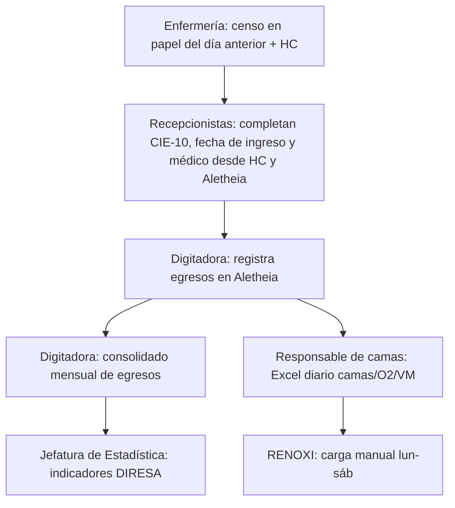
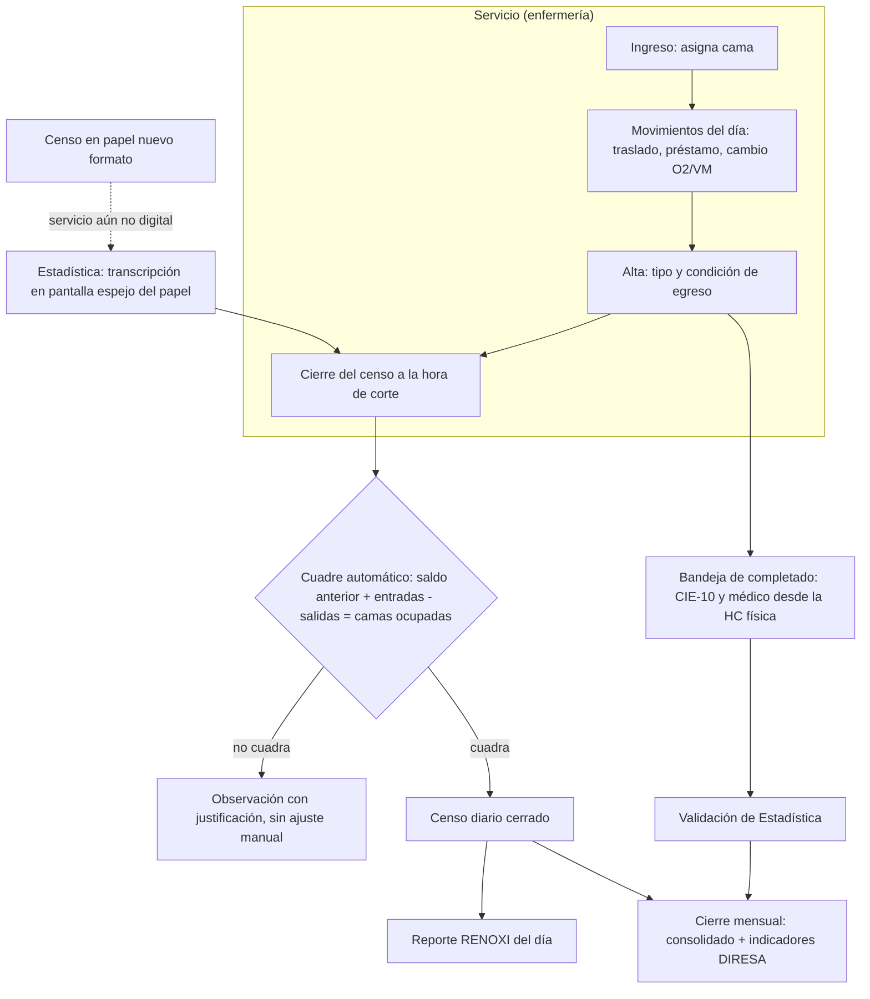
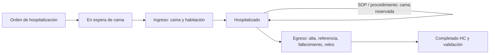

# Proceso

## Cómo funciona hoy

Proceso diario. Dos salidas (indicadores DIRESA y RENOXI) que **no comparten
fuente**.



| Paso | Responsable | Entrada | Salida | Problema |
|---|---|---|---|---|
| 1. Emitir censo | Enfermería (23 censos) | Pacientes en sala | Censo en papel: HC, nombre, edad, cama | Faltan CIE-10, fecha de ingreso, médico, tipo de movimiento |
| 2. Completar censo | 2 recepcionistas | Censo + HC física + Aletheia | Censo completado a mano | Búsqueda manual; no hay registro de ingresos |
| 3. Registrar egresos | Digitadora | Censo completado | Egresos en Aletheia, consolidado mensual | Traslados anotados como altas |
| 4. Excel de camas | Responsable de camas | Censos | Excel diario (1 hoja por día) | Cuadre forzado; dotación mixta de 235 |
| 5. RENOXI | Responsable de camas | Excel | Formulario web (≥ 20 días/mes) | Sin API |
| 6. Indicadores | Jefatura de Estadística | Consolidado | 3 reportes DIRESA | Pacientes-día distintos al Excel |

## Cómo funcionará con el sistema

El principio: **el sistema registra movimientos, no egresos**. Cada ingreso,
traslado, préstamo y alta se registra una vez, sobre una cama concreta. El
censo, los egresos, los pacientes-día, el reporte RENOXI y los indicadores se
**calculan** de esos movimientos; nadie los vuelve a digitar.



### Ingreso obligatorio y flujo completo del paciente

Hasta hoy solo se subían egresos; nadie fuera del censo en papel sabe qué
pacientes están hospitalizados. Desde el arranque el sistema **exige el
ingreso**:

- No se puede ocupar una cama sin una hospitalización abierta.
- No se puede dar de alta a quien no tiene ingreso.
- En un censo transcrito, un paciente que aparece sin ingreso obliga a
  registrarlo (con la fecha de la HC) antes de cerrar el censo.
- El día de arranque de cada servicio se toma un **censo inicial**: cada
  paciente presente recibe un ingreso con su fecha real de la HC o, si no se
  ubica, marcado como *ingreso previo al sistema*, para no distorsionar las
  estancias.



**El ingreso es el registro completo; el egreso es corto.** En el ingreso se
captura al paciente (documento, nombres, HC, edad, sexo), la cama, la fecha y
la hora. En el egreso solo se indica el médico que dio el alta, la fecha, la
hora y el tipo (o el destino si es traslado): todo lo demás se jala del
ingreso.

No se exige registrar en el momento: la enfermera puede anotar la hora
aproximada en una hoja de movimientos y digitarlo cuando tenga tiempo, hasta
la recogida del censo a las 08:00 del día siguiente. El sistema es un
**consolidado diario confiable**, no un monitor al minuto.

```mermaid
timeline
  title Censo del 25 de octubre
  25 00:00 : Abre el censo del 25
  25 durante el día : Ingresos y egresos (en el sistema o en la hoja, con hora aproximada)
  25 23:59 : Cierre del censo del 25
  26 00:00 : Abre el censo del 26 en el área
  26 08:00 : Estadística recoge el censo del 25 y queda bloqueado
```

De cada paciente queda su **trayectoria**: fecha y hora de ingreso y egreso,
DNI, nombres, HC, y cada tramo con ID de cama, ID de habitación, servicio y
departamento. El estado *En espera de cama* solo se usa si Admisión o
Emergencia registran la orden (ver preguntas abiertas).

### Actividades que maneja el sistema

| # | Actividad | Quién | Cuándo | Qué registra o produce |
|---|---|---|---|---|
| 1 | **Ingreso** | Enfermería (o Estadística al transcribir) | Al ocupar la cama | Paciente (búsqueda por HC/DNI en el padrón), fecha y hora, cama, servicio que atiende, procedencia (emergencia, consulta, referencia, otro servicio), diagnóstico de ingreso opcional |
| 2 | **Traslado interno** | Enfermería del servicio de origen; el destino lo confirma | Al mover al paciente | Origen, destino, cama destino, fecha y hora. **No es egreso** |
| 3 | **Préstamo de cama** | Enfermería del servicio que atiende | Al ocupar una cama de otro servicio | Cama (servicio dueño) y servicio que atiende. El paciente cuenta para el que atiende |
| 4 | **Cambio de soporte** | Enfermería | Al iniciar o retirar O2/VM | Soporte por paciente: ninguno, O2, VM (necesario para RENOXI) |
| 5 | **Egreso (alta)** | Enfermería | Al salir el paciente del hospital | Fecha y hora, tipo de egreso, condición; libera la cama. Queda *pendiente de completar* |
| 6 | **Cierre de censo** | Enfermería (o Estadística) | Diario; el de D, antes de las 08:00 de D+1 | Foto del día: pacientes por cama, soporte, ingresos, egresos, traslados. Cuadre automático |
| 7 | **Completado desde HC** | Técnicos de Estadística | Al recibir la HC física | CIE-10 principal y secundarios, médico del alta, verificación de fechas. Ver [Completado desde la HC física](completado-hc.md) |
| 8 | **Validación** | Jefatura / técnicos de Estadística | Diario o semanal | Revisión de inconsistencias, egreso pasa a *validado* |
| 9 | **Reporte RENOXI** | Responsable de camas | Lun-sáb | Vista agrupada como el formulario RENOXI; marca "cargado" para controlar los 20 días/mes |
| 10 | **Cierre mensual** | Jefatura de Estadística | Primeros días del mes | Bloquea el periodo, emite consolidado e indicadores DIRESA (hospitalización general, UCI, UTIN) |
| 11 | **Mantenimiento de maestros** | Jefatura de Estadística / TI | Cuando cambia | Camas, dotación vigente (con fecha y resolución), servicios, médicos, mapeos RENOXI/DIRESA |
| 12 | **Migración de Aletheia** | Sistema / TI | Una vez, y réplica durante el paralelo | Padrón de pacientes, CIE-10, médicos e histórico; el sistema reemplaza a Aletheia |
| 13 | **Reporte de cama con falla** | Enfermería | En el censo del día | Novedad de cama; abre orden de mantenimiento. Ver [Camas, habitaciones y mantenimiento](camas-y-mantenimiento.md) |
| 14 | **Retiro y reparación** | Mantenimiento | Al atender la orden | Retiro, reemplazo o no, diagnóstico, reparada o de baja |
| 15 | **Devolución de cama** | Mantenimiento y enfermería | Al entregar | Mantenimiento entrega, enfermería confirma; el puesto vuelve a Libre |
| 16 | **Censo inicial** | Enfermería / Estadística | Arranque de cada servicio | Ingresos de todos los pacientes presentes |

### Qué entra y qué sale

**Entradas**

- Del padrón (Aletheia): N° de HC, documento, nombres, sexo, fecha de nacimiento.
- De enfermería: cama, fecha/hora de cada movimiento, servicio que atiende,
  soporte O2/VM, tipo y condición de egreso.
- De la HC física: CIE-10 de egreso (principal y secundarios), médico que dio
  el alta, corrección de la fecha de ingreso si difiere.
- De maestros: dotación vigente, camas, hora de corte, agrupaciones RENOXI y DIRESA.

**Salidas**

- Mapa de camas en tiempo real, en vista isométrica por habitación (libre,
  ocupada, prestada, bloqueada, fuera de servicio).
- Trayectoria de cada paciente (ingreso, tramos, egreso).
- Órdenes de mantenimiento y días-cama perdidos por cama fuera de servicio.
- Censo diario por servicio, imprimible y firmado.
- Reporte RENOXI diario (ocupadas con/sin O2 o VM, disponibles, por grupo).
- Consolidado mensual de egresos por servicio y departamento.
- Indicadores DIRESA (A a I) por departamento con la dotación vigente del mes.
- Indicadores de calidad del dato (egresos pendientes, antigüedad, censos sin cerrar).

### Unidades especiales

| Unidad | Tratamiento |
|---|---|
| Medicina A, Medicina B, Medicina Intermedios | Servicios con camas propias: 24, 24 y 5 (53 en total, según el conteo físico). |
| Psiquiatría V/M | Un solo grupo de camas; el servicio (V/M) se marca por paciente, salvo que el mapeo físico muestre un reparto. |
| UTIN A, B y C | Un solo servicio de 22 camas. |
| Emergencia Adultos (Contingencia + Observación Medicina + Tópico), Emergencia Pediátrica | Se registran para RENOXI; fuera de dotación e indicadores. Tópico tendrá censo propio en el sistema. |
| Trauma Shock | Sin censo hoy: se registra como conteo diario desde Emergencia; se guarda, no se remite. |
| Alojamiento Conjunto, Atención Inmediata | Fuera de dotación; qué se cuenta (madre, RN o ambos) está pendiente. |

## Diagramas

Los diagramas de esta página están en Mermaid. Para versiones editables:

1. Dibújalo en [draw.io](https://app.diagrams.net) (o con la extensión de
   draw.io de VS Code) y guárdalo como **`.drawio.svg`**.
2. Súbelo a esta carpeta, `docs/proceso/`.
3. Enlázalo aquí como imagen:

```markdown

```
