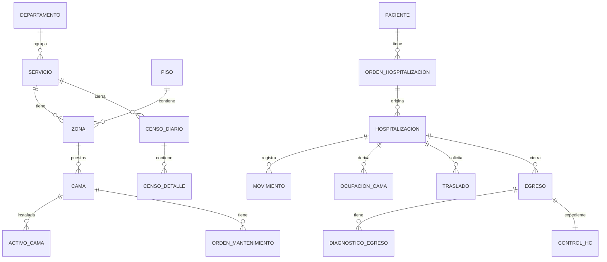

# Tarea: crear la base de datos PostgreSQL

| | |
|---|---|
| **Estado** | Implementada en `backend/`. Falta la migración de Aletheia |
| **Rama base** | `prototype` |
| **Resultado** | Migraciones, semillas, API y pruebas en `backend/`; frontend conectado |
| **Motor** | PostgreSQL 16 |

> Las decisiones del 2026-11-09 cambiaron parte de lo que sigue. Donde difieran,
> manda la [sección 14](#14-cambios-del-2026-11-09), y el esquema real está en
> `backend/migraciones/sql/`.

## 1. Objetivo

Construir la base de datos que reemplaza al estado que hoy vive en el navegador
(`localStorage` e IndexedDB). El prototipo de `frontend/` ya implementa el flujo
completo. Esta base debe guardar lo mismo, con las garantías que un navegador no
puede dar: integridad entre usuarios, historial que no se borra y auditoría.

La tarea termina cuando la historia de la demostración cargada en PostgreSQL da
**exactamente los mismos números** que el prototipo (sección 11).

## 2. Alcance

**Entra**

- Esquema completo de la sección 6, con migraciones Alembic.
- Restricciones y triggers de la sección 7.
- Vistas y funciones de la sección 8.
- Carga de maestros y de la demostración (sección 9).
- Roles de base de datos y pruebas automáticas.

**No entra**

- La API FastAPI ni conectar el frontend. `datos/tienda.js` se reemplaza después.
- Migración desde Aletheia (tablas `stg_aletheia_*`). Depende de la pregunta 6.1.
- Préstamos de cama entre servicios: siguen pendientes de definir.
- Etiquetas QR, tiempo real y exportación Excel o PDF.

## 3. Fuentes y cuál manda

Lee primero `CLAUDE.md`, `docs/proceso/reglas.md`,
`docs/proceso/camas-y-mantenimiento.md` y `docs/proceso/completado-hc.md`.

Cuando dos fuentes difieran, manda este orden:

1. Esta tarea.
2. El código de `frontend/src/app/dominio/` (`hospitalizacion.js`,
   `consultas.js`, `tiempo.js`) y sus pruebas (`frontend/pruebas/flujo.test.mjs`).
3. El resto de `docs/`.

El modelo de `docs/arquitectura.md` es anterior a estas decisiones. Estas son
las diferencias que ya están resueltas:

| Tema | `docs/arquitectura.md` | Se implementa |
|---|---|---|
| Quién origina el ingreso | Enfermería | Admisión registra una **orden** con el área; enfermería de piso confirma la cama. Hay tabla `orden_hospitalizacion` |
| Préstamo | Tipo de movimiento | No existe aún. Se deja preparado: `movimiento.servicio_id` (quien atiende) es independiente de `cama.servicio_id` (dueño) |
| Habitaciones | Tabla `habitacion` | Tabla `zona`, porque el plano también guarda pasillos, estaciones y apoyo |
| Estado de la cama | Columna `cama.estado` | Se **calcula** (vista `v_estado_cama`); solo se guarda `fuera_de_servicio` y los bloqueos |
| Tramos de ocupación | Constraint "sobre rangos", sin tabla | Tabla derivada `ocupacion_cama`, mantenida por trigger |
| Estado del egreso | Incluye `registrado` | `pendiente_hc`, `completo`, `observado`, `validado`, `cerrado`. Un traslado a servicio no incorporado no tiene estado |
| Soporte | Ninguno, O2, VM | Igual en la base. El prototipo solo usa ninguno y O2 porque aún no cubre UCI |
| Dotación por servicio | Siempre por servicio | Por servicio **o** por departamento, porque Salud Mental y la cifra oficial de Medicina (42) no tienen reparto |

## 4. Entregables

```text
backend/
  alembic.ini
  migraciones/env.py
  migraciones/versions/0001_esquema_inicial.py
  semillas/cargar_maestros.py
  semillas/cargar_demostracion.py
  pruebas/test_*.py
  requirements.txt
docker-compose.yml        # solo el servicio db, PostgreSQL 16
.env.example              # sin contraseñas reales
```

- Dependencias permitidas: Python 3.12, SQLAlchemy, Alembic, psycopg y pytest.
  Cualquier otra se pide antes, como indica `CLAUDE.md`.
- Una base vacía queda completa con `alembic upgrade head`, y
  `alembic downgrade base` la deja vacía.
- Añade a `README.md` cómo levantar la base y correr las pruebas.

## 5. Convenciones

- Tablas y columnas en español, `snake_case` y singular, sin tildes.
- **Claves.** `bigint GENERATED ALWAYS AS IDENTITY` en las tablas transaccionales.
  `text` en lo que ya tiene identificador estable: `departamento`, `servicio`,
  `piso`, `zona`, `cama`, `cuenta`, `medico` y `cie10`. Los `id` del catálogo y
  del plano **no se renombran**.
- **Valores cerrados.** `text` con `CHECK`, no tipos `ENUM`, porque un `ENUM` no
  permite quitar valores en una migración.
- **Fechas.** `timestamptz` con precisión de minuto para los hechos. El prototipo
  guarda `AAAA-MM-DDTHH:mm` en hora local: se interpreta en `America/Lima`.
- **Día del censo.** Siempre con `dia_censo()` (sección 7.1), nunca con `::date`,
  que depende de la zona de la sesión.
- **Quién y cuándo.** Toda fila de hechos lleva la cuenta que la registró y
  `registrado_en` (la hora de digitación), separada de `fecha_hora` (la hora del
  evento, que puede ser aproximada y diferida).
- **`CHECK` con nulos.** Una condición que evalúa `NULL` **pasa**. Para exigir un
  texto escribe `coalesce(trim(x), '') <> ''`, nunca `length(trim(x)) > 0`.

## 6. Modelo de datos



En las tablas siguientes, salvo que se indique otra cosa, cada columna es
`NOT NULL`. La marca **null** indica que admite nulos.

### 6.1 Maestros físicos

**`departamento`**: `id` text PK · `nombre` text único · `en_dotacion` boolean
(lo contrario de `fueraDeDotacion`) · `reporte_diresa` text null, `CHECK` en
(`hospitalizacion`, `uci`, `utin`) · `activo` boolean default true.

**`servicio`**: `id` text PK · `departamento_id` FK · `nombre` text único ·
`modalidad_captura` text `CHECK` en (`papel`, `digital`) · `fila_renoxi` text null ·
`camas_referencia` int null · `activo` boolean default true.

**`piso`**: `id` text PK · `nombre` text · `ancho`, `alto` numeric(6,2), en metros.

**`zona`** (`plano.zonas`): `id` text PK · `piso_id` FK · `tipo` text `CHECK` en
(`habitacion`, `pasillo`, `estacion`, `apoyo`) · `codigo` text default `''` ·
`nombre` text default `''` · `servicio_id` FK **null** · `x`, `y`, `ancho`, `alto`
numeric(6,2).

- `CHECK (tipo <> 'habitacion' OR (servicio_id IS NOT NULL AND codigo <> ''))`.
- Índice único `(piso_id, codigo) WHERE codigo <> ''`: las zonas de apoyo llegan
  con código vacío.

**`cama`** (el puesto, `plano.camas`): `id` text PK · `zona_id` FK ·
`servicio_id` FK · `codigo` text único · `tipo` text `CHECK` en (`adulto`, `uci`,
`pediatrica`, `cuna`) · `x`, `y` numeric(6,2), relativas a la zona · `rotacion`
smallint `CHECK` en (0, 90, 180, 270) · `fuera_de_servicio` boolean default false.

En el archivo, `servicioId` de la cama viene `null` y se hereda de la zona: el
importador lo resuelve, como `maestroDesdePlano`.

**`bloqueo_cama`** (`cama.bloqueo`): `id` · `cama_id` FK · `motivo` text ·
`desde` timestamptz · `hasta` timestamptz **null** · `bloqueado_por`,
`desbloqueado_por` (**null**) FK cuenta. Índice único `(cama_id) WHERE hasta IS NULL`.

**`activo_cama`** (la cama física): `id` · `codigo_interno` text único (hoy
`CAM-<codigo>`) · `codigo_patrimonial` text null, único · `tipo` text · `cama_id`
FK **null** (puesto actual) · `estado` text `CHECK` en (`en_uso`, `reportada`,
`en_mantenimiento`, `en_almacen`, `de_baja`). Índice único
`(cama_id) WHERE cama_id IS NOT NULL`.

**`orden_mantenimiento`** (`ordenesCama`): `id` · `cama_id` FK · `activo_id` FK ·
`falla` text · `reportada_en` timestamptz · `reportada_por` FK · `estado` text
`CHECK` en (`pendiente_retiro`, `en_reparacion`, `lista_entrega`, `por_recibir`,
`cerrada`) · `con_reemplazo` boolean null · `activo_reemplazo_id` FK null ·
`retirada_en`, `resuelta_en`, `entregada_en`, `recibida_en` timestamptz null ·
`diagnostico` text null · `resultado` text null `CHECK` en (`reparada`, `baja`).
Índice único `(cama_id) WHERE estado <> 'cerrada'`.

### 6.2 Cuentas y catálogos

**`cuenta`** (`datos/cuentas.js`): `id` text PK · `usuario` text único · `nombre`
text · `rol` text `CHECK` en (`admision`, `enfermeria`, `tecnico`, `camas`,
`jefatura`, `mantenimiento`, `consulta`, `ti`, `sistema`) · `clave_hash` text
**null** · `activo` boolean default true · `CHECK (rol = 'sistema' OR clave_hash IS NOT NULL)`.

**`cuenta_servicio`**: `cuenta_id` FK · `servicio_id` FK · PK compuesta.

Los módulos de cada cuenta y la matriz `PERMISOS` son configuración de la API:
no van a la base.

**`medico`**: `id` text PK · `nombre` text · `activo` boolean default true.

**`cie10`**: `codigo` text PK · `nombre` text · `activo` boolean default true.

**`paciente`**: `id` · `n_hc` text único `CHECK (n_hc ~ '^[0-9]{4,10}$')` ·
`tipo_documento` text `CHECK` en (`dni`, `ce`, `pasaporte`, `sin_documento`) ·
`numero_documento` text null · `nombres` text (formato `Apellidos, Nombres`) ·
`sexo` text `CHECK` en (`F`, `M`) · `fecha_nacimiento` date · `origen` text
`CHECK` en (`local`, `aletheia`) · `registrado_en` timestamptz.

- `CHECK (tipo_documento <> 'dni' OR numero_documento ~ '^[0-9]{8}$')`.
- `CHECK (tipo_documento = 'sin_documento' OR numero_documento IS NOT NULL)`.
- Único `(tipo_documento, numero_documento) WHERE numero_documento IS NOT NULL`.
- Índice GIN `lower(nombres) gin_trgm_ops` para buscar por nombre.

### 6.3 Flujo de hospitalización

**`orden_hospitalizacion`** (`ordenes`): `id` · `paciente_id` FK · `origen` text
`CHECK` en (`consulta_externa`, `emergencia`) · `servicio_id` FK (el área) ·
`fecha_hora` timestamptz · `medico_ordena`, `diagnostico_ingreso`, `enviada_por`
text null · `estado` text `CHECK` en (`pendiente`, `ingresada`, `anulada`) ·
`motivo_anulacion` text null · `registrada_por` FK.

- `CHECK (origen <> 'emergencia' OR coalesce(trim(enviada_por), '') <> '')`.
- `CHECK (estado <> 'anulada' OR coalesce(trim(motivo_anulacion), '') <> '')`.
- Único `(paciente_id) WHERE estado = 'pendiente'`.

**`hospitalizacion`**: `id` · `paciente_id` FK · `orden_id` FK **null** · `origen`
text · `fecha_ingreso` timestamptz · `diagnostico_ingreso` text null · `estado`
text default `abierta`, `CHECK` en (`abierta`, `egresada`, `anulada`) ·
`ingreso_previo_sistema` boolean default false.

- `CHECK (orden_id IS NOT NULL OR ingreso_previo_sistema)`.
- Único `(paciente_id) WHERE estado = 'abierta'`.
- Único `(orden_id) WHERE estado <> 'anulada'`. Una orden puede tener varias
  hospitalizaciones anuladas: anular el ingreso la devuelve a `pendiente`.

**`movimiento`** (fuente única): `id` · `hospitalizacion_id` FK · `tipo` text ·
`fecha_hora` timestamptz · `dia` date generada · `registrado_en` timestamptz
default `now()` · `cuenta_id` FK · `cama_id` FK · `servicio_id` FK (quien atiende)
· `servicio_origen_id`, `cama_origen_id` FK null · `soporte` text null ·
`tipo_egreso` text null · `anulado` boolean default false · `motivo_anulacion`,
`anulado_en`, `anulado_por` null. Definición en la sección 7.2.

**`ocupacion_cama`** (derivada): sección 7.2. Nadie escribe en ella salvo el trigger.

**`traslado`** (entre servicios, a la espera del destino): `id` ·
`hospitalizacion_id` FK · `servicio_origen_id`, `servicio_destino_id` FK ·
`cama_origen_id` FK · `solicitado_en` timestamptz · `solicitado_por` FK · `estado`
text `CHECK` en (`pendiente`, `confirmado`, `cancelado`) · `confirmado_en` null ·
`confirmado_por` null · `movimiento_id` FK null.

- `CHECK (servicio_origen_id <> servicio_destino_id)`.
- Único `(hospitalizacion_id) WHERE estado = 'pendiente'`.

Un cambio de cama dentro del mismo servicio es un `movimiento` directo, sin fila
en `traslado`.

**`egreso`** (`hospitalizacion.egreso`): `id` · `hospitalizacion_id` FK ·
`movimiento_id` FK · `fecha_hora` timestamptz · `tipo` text `CHECK` en
(`alta_medica`, `alta_voluntaria`, `fuga`, `referido`, `fallecido_menor_48`,
`fallecido_mayor_48`, `traslado_no_incorporado`) · `condicion` text null `CHECK` en
(`curado`, `mejorado`, `igual`, `peor`, `fallecido`) · `destino` text null ·
`servicio_id` FK · `medico_id` FK null · `estado` text null `CHECK` en
(`pendiente_hc`, `completo`, `observado`, `validado`, `cerrado`) ·
`motivo_observacion` text null · `completado_en`, `validado_en` null ·
`completado_por`, `validado_por` FK null · `anulado` boolean default false.

- Único `(hospitalizacion_id) WHERE NOT anulado`.
- Si `tipo = 'traslado_no_incorporado'`: `estado` nulo y `destino` obligatorio.
- En cualquier otro tipo: `estado` y `condicion` obligatorios.
- `CHECK (estado NOT IN ('completo','validado','cerrado') OR medico_id IS NOT NULL)`.

El prototipo borra el egreso al anular el movimiento. Aquí se marca
`anulado = true` y la hospitalización vuelve a `abierta`.

**`diagnostico_egreso`**: `egreso_id` FK · `cie10` FK · `principal` boolean ·
`orden` smallint · PK `(egreso_id, cie10)`. Único `(egreso_id) WHERE principal`.

**`control_hc`**: `egreso_id` PK y FK · `estado` text `CHECK` en
(`pendiente_entrega`, `recibida`, `completada`, `devuelta`) · `recibida_en`,
`completada_en`, `devuelta_en` null · `recibida_por`, `devuelta_por` FK null. Solo
existe para egresos hospitalarios.

### 6.4 Censo

**`censo_diario`** (`censos`): `id` · `servicio_id` FK · `fecha` date · `estado`
text `CHECK` en (`abierto`, `cerrado`, `reabierto`) · `saldo_anterior`, `ingresos`,
`traslados_entrada`, `egresos`, `traslados_salida`, `pacientes_corte`,
`entraron_y_salieron`, `pacientes_dia`, `conteo_fisico` integer null ·
`observacion` text null · `cerrado_en`, `cerrado_por` null · `motivo_reapertura`,
`reabierto_en`, `reabierto_por` null. Único `(servicio_id, fecha)`.

- Con `estado = 'cerrado'`, todos los conteos son obligatorios.
- Si `conteo_fisico <> pacientes_corte`, o si
  `saldo_anterior + ingresos + traslados_entrada - egresos - traslados_salida <> pacientes_corte`,
  la `observacion` es obligatoria.
- `CHECK (estado <> 'reabierto' OR coalesce(trim(motivo_reapertura), '') <> '')`.

**`censo_detalle`** (foto al cerrar, `filasCenso`): `id` · `censo_id` FK ·
`cama_id` FK null · `hospitalizacion_id` FK null · `estado_cama` text null (`libre`,
`bloqueada` o `fuera`, en filas sin paciente) · `movimiento` text null (`I · E`) ·
`relacion` text null · `soporte` text null · `dias_estancia` int null ·
`tipo_egreso` text null · `presente_al_corte` boolean · `observacion` text null.
Al volver a cerrar un censo reabierto se reemplazan sus filas; la auditoría
conserva las anteriores.

**`censo_nota`** (`censos[…].notas`, mientras el censo está abierto): `censo_id`
FK · `hospitalizacion_id` FK · `nota` text · PK compuesta.

Las novedades de camas del censo no se guardan: se calculan de
`orden_mantenimiento`, como `novedadesCenso`.

### 6.5 Periodos, dotación y reportes

**`dotacion_version`**: `id` text PK · `nombre` text · `documento` text null ·
`vigente_desde` date · `vigente_hasta` date null.

**`dotacion_detalle`**: `version_id` FK · `departamento_id` FK · `servicio_id` FK
**null** · `n_camas` int. `UNIQUE NULLS NOT DISTINCT (version_id, departamento_id, servicio_id)`.
Con `servicio_id` nulo, la cifra es del departamento completo.

**`periodo`**: `mes` date PK, `CHECK (extract(day FROM mes) = 1)` · `estado` text
`CHECK` en (`abierto`, `cerrado`) · `dotacion_version_id` FK null · `cerrado_en`,
`cerrado_por` null.

**`renoxi_carga`**: `dia` date PK · `cargado_en` timestamptz · `cuenta_id` FK.

**`parametro`**: `clave` text · `vigente_desde` date · `valor` jsonb · PK compuesta.

### 6.6 Trazabilidad

**`bitacora`** (la que ve el módulo *Cuentas y bitácora*): `id` · `fecha_hora`
timestamptz · `cuenta_id` FK · `ip` inet null · `tipo` text (`censo/cerrar`…) ·
`descripcion` text (ver `DESCRIPCION` en `hospitalizacion.js`) · `detalle` text.

**`auditoria`** (cambio por cambio, por trigger): sección 7.5.

## 7. Reglas que garantiza la base

Este SQL se ejecutó contra el plano real y la historia de la demostración, en un
PostgreSQL embebido (PGlite, motor 18), y todavía falta correrlo en un servidor 16.
Úsalo tal cual o mejóralo, pero conserva el comportamiento.

### 7.1 Extensiones y día del censo

```sql
CREATE EXTENSION IF NOT EXISTS btree_gist;
CREATE EXTENSION IF NOT EXISTS pg_trgm;

CREATE FUNCTION dia_censo(ts timestamptz) RETURNS date
  LANGUAGE sql IMMUTABLE PARALLEL SAFE
  RETURN (ts AT TIME ZONE 'America/Lima')::date;
```

### 7.2 Movimiento y una sola ocupación por cama

```sql
CREATE TABLE movimiento (
  id bigint GENERATED ALWAYS AS IDENTITY PRIMARY KEY,
  hospitalizacion_id bigint NOT NULL REFERENCES hospitalizacion,
  tipo text NOT NULL CHECK (tipo IN ('ingreso','traslado','soporte','egreso')),
  fecha_hora timestamptz NOT NULL,
  dia date GENERATED ALWAYS AS (dia_censo(fecha_hora)) STORED,
  registrado_en timestamptz NOT NULL DEFAULT now(),
  cuenta_id text NOT NULL REFERENCES cuenta,
  cama_id text NOT NULL REFERENCES cama,
  servicio_id text NOT NULL REFERENCES servicio,
  servicio_origen_id text REFERENCES servicio,
  cama_origen_id text REFERENCES cama,
  soporte text CHECK (soporte IN ('ninguno','o2','vm')),
  tipo_egreso text,
  anulado boolean NOT NULL DEFAULT false,
  motivo_anulacion text,
  anulado_en timestamptz,
  anulado_por text REFERENCES cuenta,
  CHECK (NOT anulado OR coalesce(trim(motivo_anulacion), '') <> ''),
  CHECK (tipo <> 'traslado' OR (servicio_origen_id IS NOT NULL AND cama_origen_id IS NOT NULL)),
  CHECK ((tipo = 'soporte') = (soporte IS NOT NULL)),
  CHECK ((tipo = 'egreso') = (tipo_egreso IS NOT NULL))
);
CREATE UNIQUE INDEX un_ingreso_vigente ON movimiento (hospitalizacion_id)
  WHERE tipo = 'ingreso' AND NOT anulado;
CREATE UNIQUE INDEX un_egreso_vigente ON movimiento (hospitalizacion_id)
  WHERE tipo = 'egreso' AND NOT anulado;

CREATE TABLE ocupacion_cama (
  id bigint GENERATED ALWAYS AS IDENTITY PRIMARY KEY,
  hospitalizacion_id bigint NOT NULL REFERENCES hospitalizacion,
  cama_id text NOT NULL REFERENCES cama,
  servicio_id text NOT NULL REFERENCES servicio,
  desde timestamptz NOT NULL,
  hasta timestamptz,
  rango tstzrange GENERATED ALWAYS AS (tstzrange(desde, hasta, '[)')) STORED,
  CHECK (hasta IS NULL OR hasta > desde),
  CONSTRAINT cama_sin_choque EXCLUDE USING gist (cama_id WITH =, rango WITH &&)
);
CREATE UNIQUE INDEX un_tramo_abierto ON ocupacion_cama (hospitalizacion_id)
  WHERE hasta IS NULL;

CREATE FUNCTION reconstruir_ocupacion() RETURNS trigger LANGUAGE plpgsql AS $$
BEGIN
  DELETE FROM ocupacion_cama WHERE hospitalizacion_id = NEW.hospitalizacion_id;
  INSERT INTO ocupacion_cama (hospitalizacion_id, cama_id, servicio_id, desde, hasta)
  SELECT hospitalizacion_id, cama_id, servicio_id, fecha_hora, siguiente
  FROM (
    SELECT m.*, lead(fecha_hora) OVER (ORDER BY fecha_hora, id) AS siguiente
    FROM movimiento m
    WHERE m.hospitalizacion_id = NEW.hospitalizacion_id
      AND NOT m.anulado AND m.tipo <> 'soporte'
  ) t
  WHERE tipo <> 'egreso' AND (siguiente IS NULL OR siguiente > fecha_hora);
  RETURN NULL;
END $$;

CREATE TRIGGER movimiento_ocupacion
  AFTER INSERT OR UPDATE OF anulado, fecha_hora ON movimiento
  FOR EACH ROW EXECUTE FUNCTION reconstruir_ocupacion();
```

El rango es semiabierto: un paciente puede salir a las 11:00 y otro entrar a las
11:00 en la misma cama. El error `23P01` es el que la API traducirá a *Dos pacientes
ocuparían la cama*. Cubre también el registro diferido y anular un egreso cuando
la cama ya se reocupó.

### 7.3 Lo que no se borra

Un trigger `BEFORE DELETE` rechaza el borrado en `movimiento`, `hospitalizacion`,
`egreso`, `orden_hospitalizacion`, `orden_mantenimiento`, `traslado`, `paciente` y
`censo_diario`:

```sql
CREATE FUNCTION impedir_borrado() RETURNS trigger LANGUAGE plpgsql AS $$
BEGIN
  RAISE EXCEPTION '% no admite borrado: se anula con motivo', TG_TABLE_NAME
    USING ERRCODE = 'restrict_violation';
END $$;
```

### 7.4 Mes cerrado

Aplícalo a `movimiento`, `egreso` y `censo_diario`, adaptando la columna de fecha:

```sql
CREATE FUNCTION proteger_mes_cerrado() RETURNS trigger LANGUAGE plpgsql AS $$
BEGIN
  -- NEW.dia aún no está calculado en un trigger BEFORE: se usa fecha_hora.
  IF EXISTS (SELECT 1 FROM periodo
             WHERE estado = 'cerrado'
               AND (mes = date_trunc('month', dia_censo(NEW.fecha_hora))::date
                    OR (TG_OP = 'UPDATE'
                        AND mes = date_trunc('month', dia_censo(OLD.fecha_hora))::date))) THEN
    RAISE EXCEPTION 'El mes de ese movimiento ya está cerrado'
      USING ERRCODE = 'check_violation';
  END IF;
  RETURN NEW;
END $$;
```

Cerrar el mes pasa a `cerrado` los egresos `validado` de ese mes: hazlo **antes**
de marcar el periodo como cerrado, dentro de la misma transacción.

### 7.5 Auditoría

Trigger `AFTER INSERT OR UPDATE OR DELETE` en todas las tablas de 6.1 a 6.5, salvo
`ocupacion_cama`, que es derivada.

```sql
CREATE TABLE auditoria (
  id bigint GENERATED ALWAYS AS IDENTITY PRIMARY KEY,
  tabla text NOT NULL,
  registro_id text,
  accion text NOT NULL,
  valor_anterior jsonb,
  valor_nuevo jsonb,
  cuenta_id text,
  ip inet,
  fecha_hora timestamptz NOT NULL DEFAULT now()
);

CREATE FUNCTION auditar() RETURNS trigger LANGUAGE plpgsql AS $$
BEGIN
  INSERT INTO auditoria (tabla, registro_id, accion, valor_anterior, valor_nuevo, cuenta_id, ip)
  VALUES (
    TG_TABLE_NAME,
    COALESCE(to_jsonb(NEW)->>'id', to_jsonb(OLD)->>'id'),
    TG_OP,
    CASE WHEN TG_OP <> 'INSERT' THEN to_jsonb(OLD) END,
    CASE WHEN TG_OP <> 'DELETE' THEN to_jsonb(NEW) END,
    NULLIF(current_setting('app.cuenta_id', true), ''),
    NULLIF(current_setting('app.ip', true), '')::inet
  );
  RETURN NULL;
END $$;
```

La API abre cada transacción con
`SELECT set_config('app.cuenta_id', :cuenta, true), set_config('app.ip', :ip, true)`.
Las tablas con clave compuesta guardan su identificador en `registro_id` con una
variante del trigger.

### 7.6 Lo que queda en la API

No lo implementes en la base; aquí se anota para que no se duplique: permisos por
acción (`PERMISOS`), restricción por servicio de la cuenta, bloqueo del censo a las
08:00 de D+1, cierre del censo solo después de las 24:00, orden cronológico de los
movimientos, comprobación de cama libre al asignarla, compatibilidad del CIE-10 con
sexo y edad, y transiciones de estado.

## 8. Vistas y funciones

| Objeto | Devuelve | Debe coincidir con |
|---|---|---|
| `v_ocupacion_actual` | Hospitalización, paciente, cama, servicio y soporte de cada tramo abierto | `ocupantes` |
| `v_estado_cama` | Una fila por cama con `fuera`, `ocupada_o2`, `ocupada`, `bloqueada` o `libre`, en ese orden de prioridad | `estadoCama` |
| `v_resumen_camas` | Total, operativas, ocupadas, disponibles, con O2, fuera y bloqueadas por servicio | `resumenCamas` |
| `cuadre_censo(servicio, dia)` | Los conteos del censo | `cuadreCenso` |
| `filas_censo(servicio, dia)` | Las filas para `censo_detalle` | `filasCenso` |
| `renoxi_del_dia(dia)` | Una fila por servicio | `renoxiDelDia` |
| `mv_indicadores_mes` | Variables A a I por mes y servicio. Materializada; se refresca al cerrar censos y meses | `indicadoresDelMes` |
| `v_tablero` | Ocupación por servicio **sin ninguna columna personal** | Módulo *Tablero* |

**Pacientes al corte del día D.** Corte es `D+1 00:00` en Lima. Un movimiento a las
00:00 de D+1 pertenece al día siguiente, así que el paciente que sale a esa hora
**sigue contando** en D:

```sql
desde < :corte AND (hasta IS NULL OR hasta >= :corte)
```

No uses `rango @> :corte`: da un resultado distinto justo en la frontera.

**`cuadre_censo`**, con `inicio = D 00:00` y `corte = D+1 00:00`:

- `saldo_anterior`: pacientes en el servicio con la misma regla, usando `inicio`.
- `ingresos`: movimientos `ingreso` del servicio en `[inicio, corte)`.
- `traslados_entrada`: `traslado` hacia el servicio desde otro distinto.
- `traslados_salida`: `traslado` desde el servicio hacia otro distinto, más los
  egresos `traslado_no_incorporado`.
- `egresos`: `egreso` del servicio de cualquier otro tipo.
- `entraron_y_salieron`: hospitalizaciones que en el día entraron y salieron del
  servicio y no están al corte.
- `pacientes_dia`: `pacientes_corte + entraron_y_salieron`.

**Indicadores.** Se calculan con `base = 'mapeo'` (A son los puestos del plano) por
servicio, y `base = 'oficial'` (A sale de la dotación) a nivel departamento.

- B: suma de `pacientes_dia` de censos cerrados del mes.
- E: egresos hospitalarios en `validado` o `cerrado`.
- C: suma de estancias de esos egresos.
- D: `A × días con censo cerrado`.
- F = C / E · G = B × 100 / D · H = E / A · I = (D − B) / E, nulos si el divisor es 0.
- Estancia: `greatest(1, dia_censo(salida) - dia_censo(ingreso))`.

## 9. Semillas

**`cargar_maestros.py`, se ejecuta en todos los ambientes y es idempotente:**

| Datos | Fuente | Resultado |
|---|---|---|
| Departamentos y servicios | `datos/catalogo.js` | 16 departamentos, 25 servicios |
| Modalidad de captura | Medicina B y Medicina Intermedios `digital`; el resto `papel` | |
| Reporte DIRESA | Sección *Indicadores DIRESA* de `reglas.md` | Hospitalización 8, UCI 5, UTIN 1 |
| Plano | `datos/planos/medicina-b-piso2.json` | 1 piso, 37 zonas (11 habitaciones), 29 camas |
| Activos | Uno por cama, `CAM-<codigo>`, estado `en_uso` | 29 activos |
| Cuentas | `datos/cuentas.js` + `sistema` | 10 cuentas, con hash de una clave recibida por variable de entorno |
| Parámetros | `consultas.js` | `umbral_estancia_dias` 60, `umbral_orden_horas` 24, `umbral_traslado_horas` 6, `umbral_hc_dias` 3, `hora_recojo_censo` `08:00` |
| Dotación | Abajo | 2 versiones |

El importador del plano rechaza un `version` mayor que 2. Si una cama llega con
`estado = 'fuera_servicio'`, se carga con `fuera_de_servicio = true`.

| Versión | Contenido | Total |
|---|---|---|
| `relacion-249` (vigente, la oficial) | Las cifras de `catalogo.js` por servicio, con Salud Mental por departamento (10) y Medicina por departamento con **42** | 249 |
| `conteo-fisico-2026` | Igual, pero Medicina con sus 3 servicios (24, 24, 5) | 260 |

Quedan fuera de ambas los departamentos con `fueraDeDotacion`.

**`cargar_demostracion.py`, solo en desarrollo y pruebas.** Se niega a correr si
`APP_ENV=produccion`. Carga también `datos/clinicos.js` (23 CIE-10 y 4 médicos, que
son una muestra y son ficticios). La historia se exporta desde el prototipo, ejecutando
esto en `frontend/`:

```bash
node --input-type=module -e "import fs from 'node:fs'; import {crearSemilla} from './src/app/datos/semilla.js'; const plano = JSON.parse(fs.readFileSync('./src/app/datos/planos/medicina-b-piso2.json','utf8')); fs.writeFileSync('semilla.json', JSON.stringify(crearSemilla(plano), null, 2))"
```

- Los pacientes de ese archivo son ficticios. No lo subas al repositorio: se
  genera en cada corrida.
- Inserta los movimientos **en orden de `seq`**: la identidad desempata los
  movimientos de un mismo minuto.
- Para la carga, usa la cuenta `sistema`.

## 10. Seguridad

Son datos personales y de salud (Ley 29733).

- Roles de base: `egresos_owner` (migraciones), `egresos_app` (lectura y escritura,
  sin DDL y sin `DELETE` en las tablas de 7.3), `egresos_lectura` (solo vistas sin
  datos personales) y `egresos_respaldo`.
- `egresos_app` no puede escribir en `ocupacion_cama` ni modificar `auditoria`:
  solo los triggers, con `SECURITY DEFINER` y `search_path` fijado.
- Ninguna contraseña en el repositorio. `.env.example` lleva solo los nombres.
- La base solo guarda el hash de la clave; el hash lo genera la aplicación. La
  clave `demo` del prototipo no se migra.
- **Nada de datos reales de pacientes** en semillas, pruebas, migraciones ni logs.
- El contenedor escucha solo en la red interna y fija `TZ` y `timezone` en
  `America/Lima`.

## 11. Criterios de aceptación

Todo debe quedar cubierto por `pytest` sobre un PostgreSQL 16 real.

**Maestros.** Se obtienen los conteos de la sección 9, con 24 camas en
`medicina-b` y 5 en `medicina-intermedios`. Correr la carga dos veces no duplica nada.

**Demostración cargada.** 19 pacientes, 19 órdenes (16 `ingresada`, 3 `pendiente`),
16 hospitalizaciones (13 abiertas), 23 movimientos (16 ingresos, 1 traslado, 3
soportes, 3 egresos), 1 traslado confirmado, 2 órdenes de mantenimiento, 3 egresos
(`pendiente_hc`, `completo`, `validado`) y 6 censos cerrados.

**Censos.**

| Día | Servicio | Saldo ant. | Ing. | T. entra | Egr. | T. sale | Al corte | Pac.-día | Filas |
|---|---|---|---|---|---|---|---|---|---|
| 05/11 | B | 0 | 12 | 0 | 0 | 0 | 12 | 12 | 24 |
| 05/11 | Int. | 0 | 2 | 0 | 0 | 0 | 2 | 2 | 5 |
| 06/11 | B | 12 | 1 | 0 | 1 | 0 | 12 | 12 | 25 |
| 06/11 | Int. | 2 | 0 | 0 | 0 | 0 | 2 | 2 | 5 |
| 07/11 | B | 12 | 0 | 0 | 2 | 1 | 9 | 9 | 24 |
| 07/11 | Int. | 2 | 0 | 1 | 0 | 0 | 3 | 3 | 5 |

**Camas al final (08/11 10:30).**

| Servicio | Total | Operativas | Ocupadas | Disponibles | Con O2 | Fuera | Bloqueadas |
|---|---|---|---|---|---|---|---|
| Medicina B | 24 | 23 | 10 | 13 | 2 | 1 | 0 |
| Intermedios | 5 | 5 | 3 | 2 | 1 | 0 | 0 |

**RENOXI del 07/11.** Medicina B: 7 sin O2, 2 con O2, 14 disponibles. Intermedios:
2 sin O2, 1 con O2, 2 disponibles.

**Indicadores de 2026-11, base `mapeo`.**

| Servicio | A | B | C | D | E | F | G | H | I |
|---|---|---|---|---|---|---|---|---|---|
| Medicina B | 24 | 33 | 1 | 72 | 1 | 1,00 | 45,83 | 0,04 | 39,00 |
| Intermedios | 5 | 7 | 0 | 15 | 0 | — | 46,67 | 0,00 | — |
| Total | 29 | 40 | 1 | 87 | 1 | 1,00 | 45,98 | 0,03 | 47,00 |

**Rechazos.** Cada caso debe fallar con el código indicado:

| Caso | Código |
|---|---|
| Segunda hospitalización abierta del paciente | `23505` |
| Segundo ingreso vigente en la misma hospitalización | `23505` |
| Ingreso en una cama ocupada | `23P01` |
| Ingreso diferido que cae antes de la salida del paciente anterior | `23P01` |
| Anular un egreso cuando la cama ya se reocupó | `23P01` |
| Anular un movimiento sin motivo | `23514` |
| Movimiento en un mes cerrado | `23514` |
| Habitación sin servicio | `23514` |
| Orden de emergencia sin `enviada_por` | `23514` |
| Egreso hospitalario sin condición | `23514` |
| Borrar un movimiento | `23001` |

**Aceptados.** Salida a las 11:00 y entrada a las 11:00 en la misma cama. Un
`dia_censo` de `2026-11-06 04:59+00` devuelve `2026-11-05`.

**Auditoría.** Un cambio hecho con `app.cuenta_id` e `app.ip` queda en `auditoria`
con esa cuenta, esa IP y el valor anterior y nuevo.

**Roles.** Con `egresos_lectura`, leer `paciente` falla y leer `v_tablero` funciona.
Con `egresos_app`, `DELETE` en `movimiento` e `INSERT` en `ocupacion_cama` fallan.

**Migraciones.** `upgrade head`, `downgrade base` y otra vez `upgrade head` corren
sin errores.

## 12. Pendientes que no bloquean

Se implementa el supuesto indicado y se ajusta cuando haya respuesta.

| Tema | Supuesto para esta tarea | Quién decide |
|---|---|---|
| Cama dada de **baja** sin reemplazo. Hoy el prototipo la devuelve como libre al recibirla, y `camas-y-mantenimiento.md` dice que la baja es definitiva | La base lo permite. Al corregir `dominio/`, el activo pasa a `de_baja` y el puesto sigue fuera hasta instalar otro | Estadística y Mantenimiento |
| Cuál dotación se reporta a DIRESA y RENOXI (3.6) | Se emiten ambas bases. La oficial de Medicina es 42 por departamento y no se compara hasta mapear Medicina A | Estadística |
| Si una cama fuera de servicio resta días-cama (3.7) | No resta en la base `mapeo`, igual que el prototipo | Estadística |
| Extranjeros y pacientes NN (1.1b) | `tipo_documento`, incluido `sin_documento` | Admisión |
| HC única por paciente (1.2) | `n_hc` único | Admisión |
| Separar apellidos y nombres | Una sola columna, como el prototipo. Se revisa con el esquema de Aletheia (6.1) | Equipo |
| `fallecido_*` con condición distinta de `fallecido` | No se restringe, como el prototipo | Estadística |
| Retención de datos y bitácoras (10.3) | Sin purga | Dirección |

## 13. Orden sugerido

1. `docker-compose.yml`, Alembic y extensiones.
2. Maestros físicos y su carga, con la prueba de las 29 camas.
3. Cuentas, catálogos y paciente.
4. Orden, hospitalización, movimiento y `ocupacion_cama`, con los rechazos de la sección 11.
5. Traslado, egreso, diagnóstico y control de HC.
6. Censo, `cuadre_censo` y `filas_censo`.
7. Mantenimiento y bloqueos.
8. Dotación, periodo, indicadores y RENOXI.
9. Auditoría, bitácora y roles.
10. Carga de la demostración y comparación con las tablas de la sección 11.

## 14. Cambios del 2026-11-09

**Alcance.** Entran también la API FastAPI (`backend/app/`) y la conexión del
frontend (`datos/tienda.js`), para probar el flujo desde la interfaz. FastAPI y
uvicorn se suman a las dependencias permitidas, como fija la decisión 0001. La base
corre en el puerto 5544.

**Decisiones**

| Tema | Decisión |
|---|---|
| UCI | Incorporada: UCI Medicina (`cuidados-criticos`), UCI Cirugía y UCI Pediatría, con traslado normal y soporte VM. Su plano es provisional, con las cifras del catálogo, hasta tener el mapeo físico |
| Ingreso | Admisión valida la orden; el servicio designa la cama y con eso se confirma el ingreso |
| Admisión (Galeno) | `paciente` y `orden_hospitalizacion` llevan `id_externo`, para recibir sus datos sin cambiar el modelo |
| Corrección tras cerrar el mes | Las cifras quedan fijas en `indicador_mes_cerrado`; las correcciones van en `ajuste_periodo` y se muestran aparte |
| Préstamos | Estructura lista, apagados con el parámetro `prestamos_habilitados`. La vista marca `prestada` cuando el servicio que atiende no es el dueño de la cama |
| Sin fecha real en el censo inicial | Fecha provisional justo antes del arranque, con `fecha_ingreso_estimada`. Sale del promedio de permanencia (F) y sigue contando en E |

**Agregado al modelo**

- `servicio.fecha_arranque`; nulo significa que aún no está incorporado.
- `cama.activa`, `zona.activo` y `piso.activo`: lo que sale del plano es baja lógica.
- `paciente`: `id_externo`, `madre_id`, `fusionado_en_id`, origen `galeno`, y
  `fecha_nacimiento` opcional solo con `sin_documento`.
- `orden_hospitalizacion`: orígenes `referencia` y `otro_servicio`,
  `servicio_procedencia_id` e `id_externo`. Quien viene de otro servicio cuenta como
  traslado entrante.
- `hospitalizacion`: origen `previo_sistema` y `fecha_ingreso_estimada`.
- `egreso.alta_medica_en` y `traslado.estado = 'anulado'`.
- `dotacion_version.oficial`.
- Tablas `correccion_movimiento`, `indicador_mes_cerrado`, `ajuste_periodo` y
  `conteo_unidad_diario` (Trauma Shock; aún sin pantalla).

**Reglas**

- `v_estado_cama` admite `ocupada_vm`, y RENOXI cuenta `con_vm`.
- Censo y RENOXI de días pasados usan el estado de la cama **de ese día**.
- Corregir la fecha de ingreso a otro día exige reabrir antes los censos afectados.
- Una cama de baja sin reemplazo sigue fuera de servicio hasta que Mantenimiento
  entrega otra cama física y enfermería la recibe.

**Cifras que cambian en la sección 11.** Maestros: 2 pisos, 40 zonas, 45 camas, 45
activos y 13 cuentas. Indicadores 2026-11, fila Total: A 45, H 0,02. El resto de esa
sección se mantiene.
